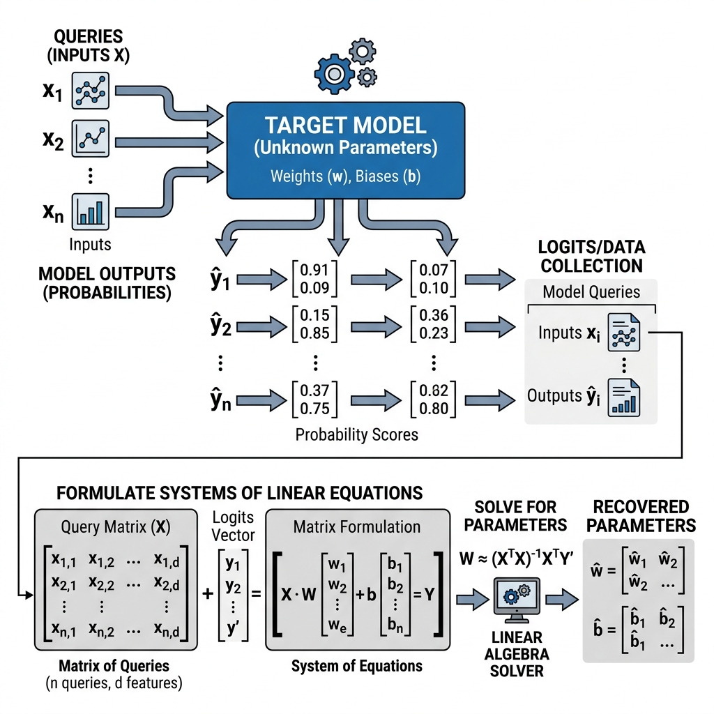

# Reading Guide & Tutorial: Stealing Machine Learning Models via Prediction APIs

**Reference**: Florian Tramèr, Fan Zhang, Ari Juels, Michael K. Reiter, and Thomas Ristenpart. *Stealing Machine Learning Models via Prediction APIs.* USENIX Security Symposium, 2016.

---

## 1. Core Summary & Taxonomy

This paper is the pioneering, foundational work that formalized **Model Extraction (Model Stealing) Attacks**. The authors analyze commercially hosted machine learning models on Cloud MLaaS platforms (such as Amazon Machine Learning, BigML, and Google Cloud Prediction API). 

### Taxonomy of the Attacks
- **Access Channel**: Query-based black-box prediction APIs (returning class classifications or confidence scores).
- **Target Model Types**: Binary and Multiclass Logistic Regression, Support Vector Machines (SVMs), Decision Trees, and Multi-Layer Perceptrons (MLPs).
- **Attacker Objective**: High-fidelity parameter extraction (recovering exact weights, splits, and biases).
- **Attacker Constraints**: Budget-restricted. The goal is to minimize the number of API queries ($N \ll B$).

---

## 2. Attack Visual Workflow

Below is the conceptual workflow of the query-based equation-solving attack introduced in this paper:

---

## 3. Explanation Gaps & Deep-Dive Tutorials

While Tramèr et al. describe the mathematical framework of their attacks, they skim over several mathematical and system details, assuming the reader is already familiar with non-linear optimization and deep learning weight properties. We address these gaps below.

---

### Gap A: L-BFGS Optimization & Gradient Backpropagation

The paper states that for Multi-Layer Perceptrons (MLPs), the weights cannot be solved analytically. Instead, the authors set up a non-linear optimization problem over query-response pairs:

$$\theta_S = \arg\min_{\theta} \sum_{j=1}^N \mathcal{L}(f_S(x_j; \theta), y_j)$$

where $y_j = f_T(x_j)$ are the soft probabilities returned by the target model, and they state they solve it using the **L-BFGS** algorithm.

#### 1. What is L-BFGS? (Why not Standard Gradient Descent?)
The standard **Broyden-Fletcher-Goldfarb-Shanno (BFGS)** algorithm is a second-order (quasi-Newton) optimization method. Unlike Gradient Descent (which only uses the gradient vector $\mathbf{g}$), quasi-Newton methods use curvature information to take faster, more direct steps toward the minimum.

A standard Newton step updates parameters as:
$$\theta_{k+1} = \theta_k - H_k^{-1} \mathbf{g}_k$$

where $H_k^{-1}$ is the inverse of the Hessian matrix (the matrix of second derivatives). However, computing the true Hessian matrix for a neural network with $M$ parameters is extremely expensive—requiring $O(M^2)$ storage and $O(M^3)$ computation time.

**BFGS** avoids this by iteratively approximating $H_k^{-1}$ using only the history of parameter changes $s_k = \theta_{k+1} - \theta_k$ and gradient differences $y_k = \mathbf{g}_{k+1} - \mathbf{g}_k$ via the secant equation:
$$H_{k+1}^{-1} = (I - \rho_k s_k y_k^T) H_k^{-1} (I - \rho_k y_k s_k^T) + \rho_k s_k s_k^T$$

**Limited-memory BFGS (L-BFGS)** takes this a step further for high-dimensional models. It does not store the full $H_k^{-1}$ matrix at all. Instead, it stores only the last $m$ vector updates ($s_k, y_k$) (typically $m \in [5, 20]$) and computes the matrix-vector multiplication $H_k^{-1} \mathbf{g}_k$ implicitly using a two-loop recursion algorithm. This reduces memory complexity from $O(M^2)$ to $O(m M)$.

#### 2. How are the Gradients $\mathbf{g}_k$ Computed?
To run L-BFGS, the solver needs the gradient of the surrogate loss function with respect to the surrogate weights $\theta_S$:
$$\mathbf{g} = \nabla_{\theta_S} \sum_{j=1}^N \text{CrossEntropy}(f_S(x_j; \theta_S), y_j)$$

This is calculated by running **Backpropagation** through the surrogate model:
1. **Forward Pass**: Feed the query inputs $x_j$ through the surrogate model to get predictions $p_j = f_S(x_j; \theta_S)$.
2. **Loss Calculation**: Compute the error difference $\delta = p_j - y_j$.
3. **Backward Pass**: Propagate the error $\delta$ backward through the surrogate model layers using the chain rule, aggregating gradients for each weight matrix:
   $$\frac{\partial \mathcal{L}}{\partial W^{(l)}} = \delta^{(l)} (h^{(l-1)})^T$$

The L-BFGS solver uses these aggregated gradients to dynamically update the surrogate weights.

---

### Gap B: Neural Network Weight Symmetries (Non-Convexity)

When minimizing the loss function for an MLP, the optimization space is highly **non-convex**. This is due to **weight symmetries** in neural networks. The paper notes that they extract "a" set of parameters that mimics the network, but doesn't detail why multiple equivalent parameter sets exist.

There are two primary types of symmetries in MLPs:

#### 1. Permutation Symmetry
In a fully connected hidden layer with $H$ hidden nodes, we can shuffle the order of the nodes without changing the output function of the network, as long as we shuffle the corresponding input and output weights.

For any hidden layer $l$ and permutation matrix $P$, we can transform the weights:
$$\tilde{W}^{(l)} = P W^{(l)}, \quad \tilde{W}^{(l+1)} = W^{(l+1)} P^T$$

Since there are $H!$ possible permutations for a layer with $H$ nodes, a network with a single hidden layer has $H!$ mathematically equivalent global minima on the loss surface.

#### 2. Scaling Symmetry (for ReLU Activations)
If the hidden layer activation function $g(z)$ is positive-homogeneous (meaning $g(\alpha z) = \alpha g(z)$ for $\alpha > 0$, which is true for ReLU), we can scale the weights of a hidden node by $\alpha$ and divide the outgoing weights by $\alpha$ without altering the output:
$$\tilde{W}^{(l)}_{i,:} = \alpha W^{(l)}_{i,:}, \quad \tilde{W}^{(l+1)}_{:,i} = \frac{1}{\alpha} W^{(l+1)}_{:,i}$$

#### 3. Implications for Model Extraction
Because of these symmetries, the L-BFGS optimizer will not recover the *exact* weight matrices $\theta_T$ used by the victim model. Instead, it recovers a permutation and scaling-equivalent matrix $\theta_S$ that represents the identical mathematical function. This is sufficient for the attacker because the resulting surrogate model $f_S(x)$ achieves near-perfect fidelity ($>99.9\%$) on all test points.
