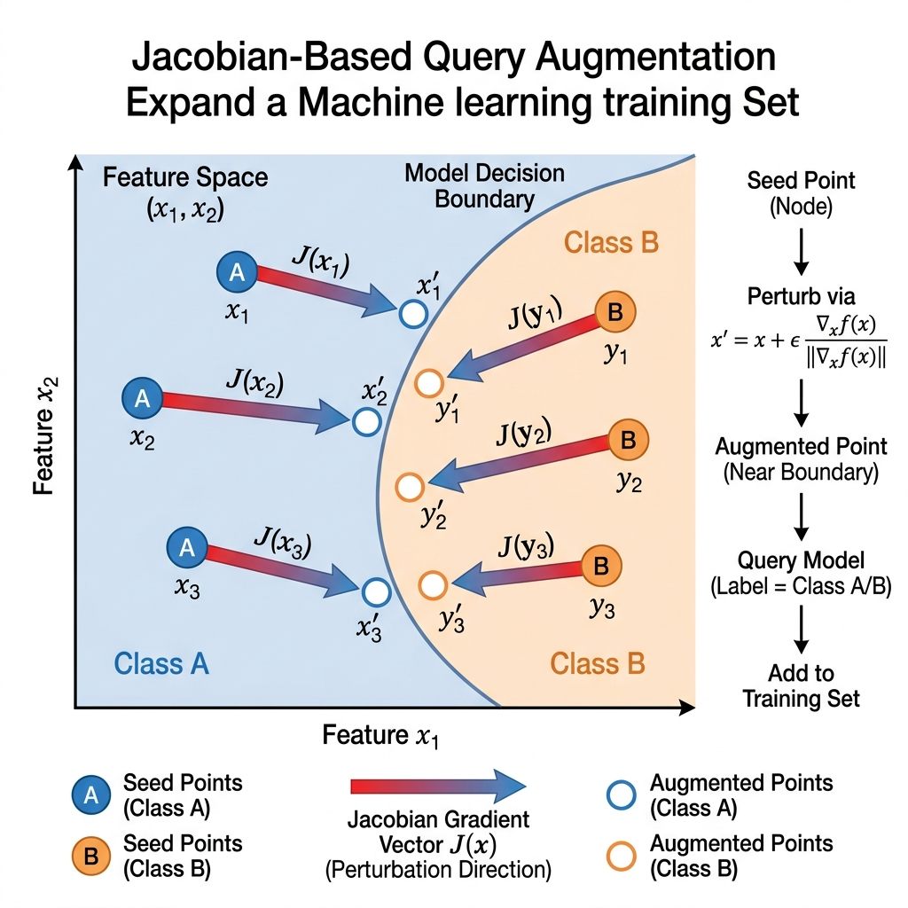

# Reading Guide & Tutorial: A Taxonomic Survey of Model Extraction Attacks

**Reference**: Didem Genç, Muhammed Ali Bingöl, and Albert Levi. *A Taxonomic Survey of Model Extraction Attacks.* Turkish Journal of Electrical Engineering & Computer Sciences, 2023.

---

## 1. Core Summary & Taxonomy

This paper presents an alternative taxonomic framework that splits model extraction attacks along two key structural axes: the **Target Model Type** (discriminative vs. generative) and the **Substitute Dataset Source** (natural vs. synthetic).

### Taxonomy of Data Sources
- **Natural Datasets**:
  - *Random Sampling*: Querying random natural points from a public distribution.
  - *Active Learning*: Selecting high-information query points near the decision boundary to minimize the API query budget.
- **Synthetic Datasets**:
  - *Generative Models*: Training a local GAN to generate query points that mimic the target model's training distribution.
  - *Jacobian-Based Synthesis*: Iteratively perturbing inputs along the target's output gradient direction to synthesize boundary-probing samples.

---

## 2. Attack Visualization

Below is the visualization of Jacobian-based query augmentation expanding a transfer dataset toward a target decision boundary:

---

## 3. Explanation Gaps & Deep-Dive Tutorials

The authors compile the taxonomy of dataset sources but omit the mathematical formulations of the active learning selection metrics and the detailed vector algebra of Jacobian perturbation.

---

### Gap A: Active Learning Query Selection Mathematics

Active learning is utilized in model extraction to select which samples to query from a large pool of unlabeled natural data $\mathcal{U}$, with the goal of training a high-fidelity surrogate using as few queries as possible. The survey references active learning, but does not provide the selection equations.

An attacker utilizes three primary **Uncertainty Sampling** metrics to select the next query $x^* \in \mathcal{U}$:

#### 1. Least Confidence
The attacker queries the instance for which the surrogate model $f_S$ is least confident in its most likely class prediction:
$$x^* = \arg\max_{x \in \mathcal{U}} \left( 1 - P(\hat{y} \mid x; \theta_S) \right)$$
where $\hat{y} = \arg\max_y P(y \mid x; \theta_S)$ is the most probable class label.

#### 2. Margin Sampling
The attacker queries the instance where the difference in probability between the most likely class ($\hat{y}_1$) and second most likely class ($\hat{y}_2$) is minimal. A small margin indicates the sample lies near the decision boundary:
$$x^* = \arg\min_{x \in \mathcal{U}} \left( P(\hat{y}_1 \mid x; \theta_S) - P(\hat{y}_2 \mid x; \theta_S) \right)$$

#### 3. Entropy-Based Sampling
The attacker queries the instance that maximizes average information entropy over all class predictions. This measures the global uncertainty of the model across the entire label distribution:
$$x^* = \arg\max_{x \in \mathcal{U}} \left( -\sum_{i=1}^c P(y_i \mid x; \theta_S) \ln P(y_i \mid x; \theta_S) \right)$$

---

### Gap B: Jacobian-Based Query Augmentation Algebra

The paper references **Jacobian-based query augmentation** (originally proposed by Papernot et al. 2017) as a synthetic dataset generation method. However, it does not explain how the Jacobian matrix is calculated or applied.

#### 1. The Jacobian Matrix
Let the surrogate model output a class probability vector $F(x) = [p_1(x), p_2(x), \dots, p_c(x)]^T$ for an input $x \in \mathbb{R}^d$. The **Jacobian matrix** $J_F(x) \in \mathbb{R}^{c \times d}$ is the matrix of all first-order partial derivatives of the output probabilities with respect to the input features:

$$J_F(x) = \begin{pmatrix} 
\frac{\partial p_1(x)}{\partial x_1} & \frac{\partial p_1(x)}{\partial x_2} & \cdots & \frac{\partial p_1(x)}{\partial x_d} \\ 
\frac{\partial p_2(x)}{\partial x_1} & \frac{\partial p_2(x)}{\partial x_2} & \cdots & \frac{\partial p_2(x)}{\partial x_d} \\ 
\vdots & \vdots & \ddots & \vdots \\ 
\frac{\partial p_c(x)}{\partial x_1} & \frac{\partial p_c(x)}{\partial x_2} & \cdots & \frac{\partial p_c(x)}{\partial x_d} 
\end{pmatrix}$$

#### 2. The Iterative Perturbation Algorithm
If the attacker wants to shift a seed input $x$ towards the decision boundary of class $y^*$:

1. **Calculate the Direction**: The gradient vector $\nabla_x p_{y^*}(x)$ points in the direction of the steepest increase in probability for class $y^*$.
2. **Apply Perturbation Step**: The input is perturbed by a small step size $\lambda$:
   $$x_{new} = x + \lambda \cdot \text{sgn}\left( \nabla_x p_{y^*}(x) \right)$$
   Using the sign function ($\text{sgn}$) ensures that features are perturbed within their input range limits (e.g. $[0, 255]$ for pixels).
3. **API Labeling**: The attacker queries the target model with $x_{new}$, receives the label $y_{new} = f_T(x_{new})$, and appends $(x_{new}, y_{new})$ to the transfer set.
4. **Iterate**: The surrogate is retrained on the expanded transfer set, a new Jacobian is computed, and the process repeats. This generates synthetic points clustered tightly around the target model's decision boundaries.
