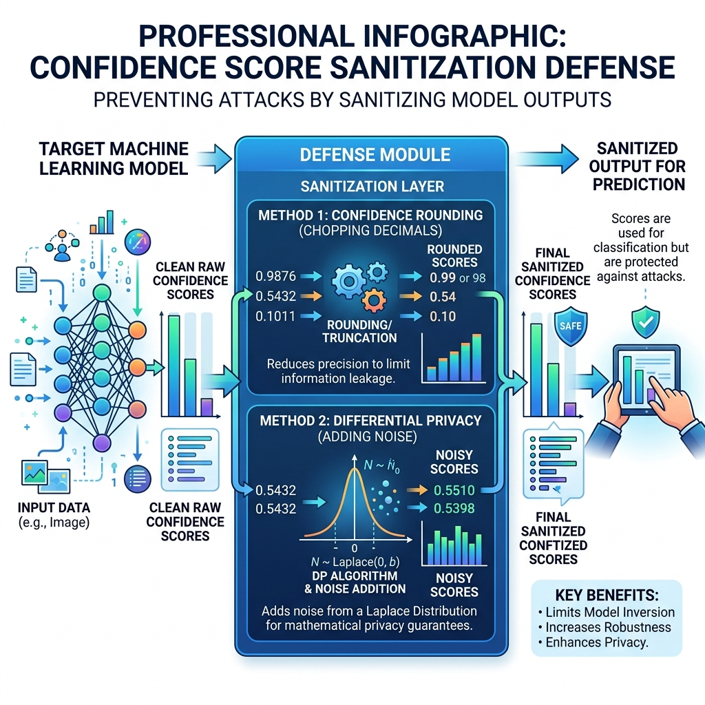

# Reading Guide & Tutorial: A Systematic Survey of Model Extraction Attacks and Defenses

**Reference**: Kaixiang Zhao, Lincan Li, Kaize Ding, Neil Zhenqiang Gong, Yue Zhao, and Yushun Dong. *A Systematic Survey of Model Extraction Attacks and Defenses: State-of-the-Art and Perspectives.* arXiv preprint arXiv:2508.15031v2, 2025.

---

## 1. Core Summary & Taxonomy

This recent survey provides a comprehensive taxonomy of model extraction, structuring it into **5 attack channels** (query-based, data-driven, side-channel, gradient-based, and modality-specific), **4 defense classes** (detection, verification, prevention, and integrated), and **3 computing environments** (cloud, edge, and federated).

### Key Defense Taxonomy
- **Detection (Inference-Time)**: Actively monitoring client query statistics (e.g. PRADA) to sound alarms on anomalies.
- **Verification (Post-Hoc)**: Active watermarking (inserting backdoors) or decision boundary fingerprinting to legally prove ownership of a stolen surrogate.
- **Prevention (Proactive)**: Sanitizing outputs before they exit the API boundary via score rounding, restricting logits to hard-labels, or adding Differential Privacy noise.

---

## 2. Defense Infographic

Below is an illustration of the proactive score sanitization defense layer using rounding and Differential Privacy:

---

## 3. Explanation Gaps & Deep-Dive Tutorials

While this survey lists score sanitization and hard-label restrictions as key prevention defenses, it skips the core mathematical proofs of Differential Privacy noise scale and boundary estimation under hard-label constraints.

---

### Gap A: Differential Privacy (DP) Output Sanitization Mathematics

MLaaS providers use **Differential Privacy** to prevent parameter extraction. The goal is to add noise to the model's confidence vector $f_T(x)$ so that an attacker cannot determine the exact internal parameters. The survey cites this defense but does not explain the noise distribution mechanics.

#### 1. Mathematical Definition of DP
A randomized algorithm $\mathcal{M}$ satisfies $\epsilon$-Differential Privacy if, for any two neighboring datasets $D_1$ and $D_2$ (differing by exactly one training record), and for any set of outputs $\mathcal{S} \subseteq \text{Range}(\mathcal{M})$:

$$P\left[ \mathcal{M}(D_1) \in \mathcal{S} \right] \le e^\epsilon \cdot P\left[ \mathcal{M}(D_2) \in \mathcal{S} \right]$$

Here, $\epsilon$ represents the **privacy budget**. A smaller $\epsilon$ provides stronger privacy (more noise), while a larger $\epsilon$ preserves utility (less noise).

#### 2. The Laplace Mechanism
To sanitize a model output vector $f_T(x)$, we add noise drawn from a zero-mean **Laplace distribution**:
$$\mathcal{M}(x) = f_T(x) + \text{Lap}(b)$$

The scale parameter $b$ of the Laplace distribution is calculated mathematically as:
$$b = \frac{\Delta f}{\epsilon}$$

where $\Delta f$ is the **global sensitivity** of the model output function. Global sensitivity measures the maximum change in model outputs when training on neighboring datasets:
$$\Delta f = \max_{D_1, D_2} \| f_{D_1}(x) - f_{D_2}(x) \|_1$$

The probability density function of the Laplace noise added to each class score is:
$$h(z) = \frac{1}{2b} e^{-\frac{|z|}{b}} = \frac{\epsilon}{2 \Delta f} e^{-\frac{\epsilon |z|}{\Delta f}}$$

By adding this Laplace noise, the confidence scores leak negligible information about individual training coordinates, preventing the attacker from solving linear systems of parameters.

---

### Gap B: Boundary Estimation Under Hard-Label Constraints

To defeat equation-solving attacks, MLaaS providers often restrict API outputs to **Hard-Labels** only (returning the predicted class index $y = \arg\max f_T(x)$, with no probability scores). The survey notes that attackers can still extract parameters, but does not explain how.

#### 1. Probing with Binary Sign Queries
When probabilities are hidden, the attacker cannot linearize logits. Instead, they treat the decision boundary as a sign boundary:
$$g(x) = \text{sgn}\left( w^T x + b \right)$$

#### 2. Zeroth-Order Boundary Estimation
To extract the weight vector $w$, the attacker uses **zeroth-order gradient estimation** along the decision boundary:

1. **Find a Boundary Point**: Find a pair of samples $x_0, x_1$ with different labels, and perform binary search to locate a point $x^*$ exactly on the boundary where $w^T x^* + b = 0$.
2. **Estimate the Normal Vector**: Perturb $x^*$ along $m$ random unit directions $\{u_1, u_2, \dots, u_m\}$ by a small step size $\delta$:
   - For each direction, query the hard-label: $y_i = g(x^* + \delta u_i)$.
   - The estimated normal vector (the direction of weights $w$) is calculated as the average of the directions that changed the label:
     $$\hat{w} \approx \frac{1}{m \delta} \sum_{i=1}^m y_i u_i$$
3. **Update and Iterate**: Move along the estimated normal vector to find adjacent boundary patches. This allows the attacker to fully reconstruct the decision boundary hyperplane using only binary sign classification outputs, though it increases the query cost $N$ by 10x to 100x compared to soft-label extraction.
