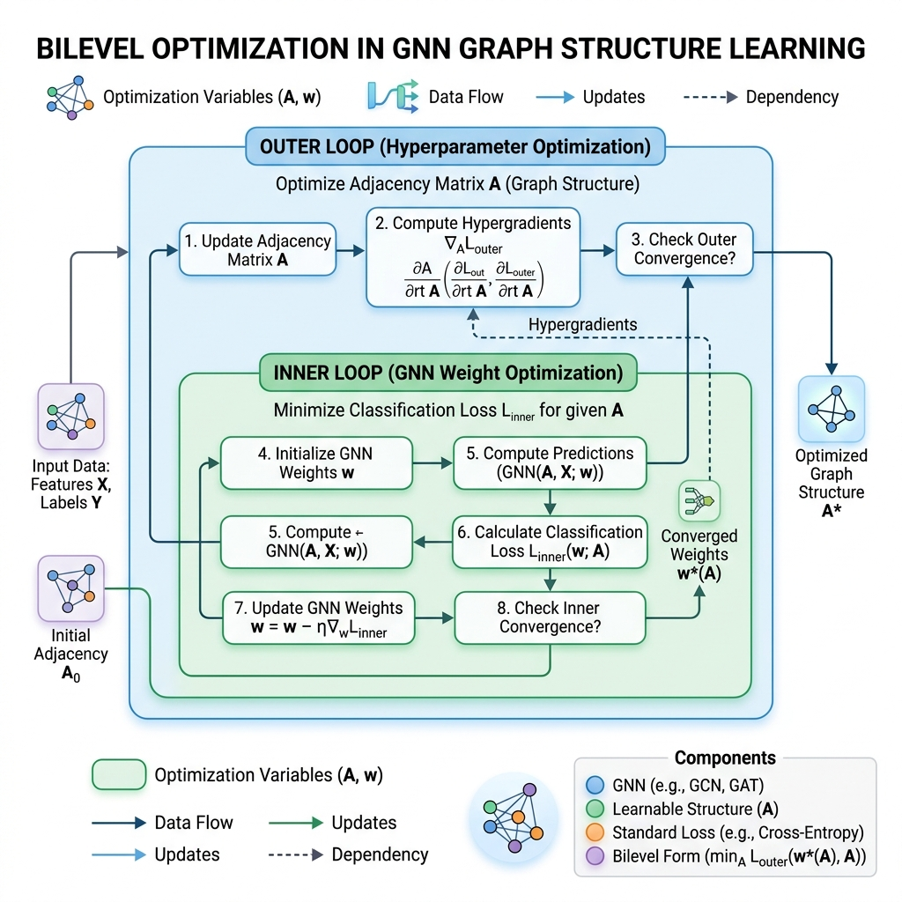

# Reading Guide & Tutorial: GNN Model Extraction Attacks

**Reference**: Bang Wu, Xiangwen Yuan, Shirui Pan, and Xingliang Yuan. *Model Extraction Attacks on Graph Neural Networks: Taxonomy and Realisation.* ACM Asia Conference on Computer and Communications Security (ASIA CCS), 2022.

---

## 1. Core Summary & Taxonomy

Unlike standard Euclidean data (images/text), Graph Neural Networks (GNNs) predict node classifications based on both node features $X$ and the graph's structural adjacency link layout $A$. The authors analyze how this interconnected structure creates new extraction pathways.

### Taxonomy of GNN Threat Levels
The authors categorize background knowledge into **7 threat levels** based on the availability of three variables:
1. **Node Attributes ($X$)**: Known attributes vs. unknown attributes.
2. **Graph Structure ($A$)**: Full adjacency matrix vs. localized k-hop connections vs. zero adjacency.
3. **Shadow Graph ($G'$)**: Access to an auxiliary graph from the same domain to train shadow models.

---

## 2. Attack Visualization

Below is the visual workflow representing **Bilevel Optimization** in GNN graph structure learning (used during structure-theft attacks):

---

## 3. Explanation Gaps & Deep-Dive Tutorials

While GNN papers discuss structural leakage and degree aggregation, they hand-wave the linear algebra of spectral graph convolutions and the complex bilevel hypergradients needed for structural recovery.

---

### Gap A: Graph Convolution & Normalization Mechanics

A standard Graph Convolutional Network (GCN) layer updates node representations $H^{(l)}$ at layer $l$ using:
$$H^{(l+1)} = \text{ReLU}\left( \hat{A} H^{(l)} W^{(l)} \right)$$
The survey references this convolution, but does not detail the normalisation matrix $\hat{A}$.

#### 1. Why Normalization is Required
Let $A \in \{0, 1\}^{N \times N}$ be the raw adjacency matrix, and $X \in \mathbb{R}^{N \times d}$ be the node features. If we perform simple aggregation $A X$, the new feature vector for a node is the sum of its neighbors' features. This has two issues:
1. **Missing Self-Features**: A node does not aggregate its own features. To fix this, we add self-loops by defining:
   $$\tilde{A} = A + I_N$$
   where $I_N$ is the identity matrix.
2. **Scale Exploded Gradients**: Nodes with a high degree (many connections) will have huge feature values, while isolated nodes will have tiny values, causing vanishing or exploding gradients.

#### 2. The Degree Normalization Formula
To scale the features appropriately, we divide the sum by the node degrees. GCNs use **symmetric normalization**:
$$\hat{A} = \tilde{D}^{-1/2} \tilde{A} \tilde{D}^{-1/2}$$

where $\tilde{D}$ is the diagonal degree matrix of $\tilde{A}$, with entries:
$$\tilde{D}_{i,i} = \sum_{j} \tilde{A}_{i,j}$$

The normalized feature aggregation for a single node $v_i$ is calculated as:
$$h^{(l+1)}_{v_i} = \text{ReLU}\left( \sum_{v_j \in \mathcal{N}(v_i) \cup \{v_i\}} \frac{1}{\sqrt{\tilde{D}_{i,i} \tilde{D}_{j,j}}} h^{(l)}_{v_j} W^{(l)} \right)$$

This degree-adjusted weighting scales features dynamically based on local density, which GNN attackers exploit to synthesize missing features through localized averaging.

---

### Gap B: Bilevel Optimization & Hypergradient Derivation in LDS

To steal a GNN when the graph structure $A$ is unknown, the attacker treats $A$ as a parameterized set of edge probabilities and runs **Learning Discrete Structures (LDS)**. The paper references this optimization, but does not detail the mathematical bilevel gradient steps.

#### 1. Bilevel Formulation
LDS treats model extraction as a nested optimization problem:

$$\text{Outer Loop (Optimize Structure } A): \quad \min_{A} \mathcal{L}_{val}\left( W^*(A), A \right)$$
$$\text{Inner Loop (Optimize Weights } W): \quad W^*(A) = \arg\min_W \mathcal{L}_{train}\left( W, A \right)$$

The outer loop optimizes the graph structure parameters $A$ by evaluating validation performance with the optimized weights $W^*(A)$ found by the inner loop GNN training.

#### 2. The Hypergradient Challenge
To update the graph parameters $A$ using gradient descent, we need the gradient of the outer loss with respect to $A$. By the chain rule:

$$\nabla_A \mathcal{L}_{val} = \frac{\partial \mathcal{L}_{val}}{\partial A} + \frac{\partial \mathcal{L}_{val}}{\partial W^*} \frac{\partial W^*(A)}{\partial A}$$

The second term requires computing $\frac{\partial W^*(A)}{\partial A}$—how the optimal neural network weights change as the graph structure changes. Since $W^*$ is the result of an iterative optimization path (e.g. 200 epochs of Adam), we compute this using **implicit differentiation**:

Because $W^*$ minimizes the inner loss $\mathcal{L}_{train}$, the gradient at $W^*$ is zero:
$$\nabla_W \mathcal{L}_{train}(W^*(A), A) = 0$$

Differentiating both sides with respect to $A$ yields:
$$\nabla^2_{W,A} \mathcal{L}_{train} + \nabla^2_{W,W} \mathcal{L}_{train} \cdot \frac{\partial W^*(A)}{\partial A} = 0$$

Solving for the derivative:
$$\frac{\partial W^*(A)}{\partial A} = - \left( \nabla^2_{W,W} \mathcal{L}_{train} \right)^{-1} \nabla^2_{W,A} \mathcal{L}_{train}$$

Substituting this back into the hypergradient equation gives:
$$\nabla_A \mathcal{L}_{val} = \frac{\partial \mathcal{L}_{val}}{\partial A} - \frac{\partial \mathcal{L}_{val}}{\partial W^*} \left( \nabla^2_{W,W} \mathcal{L}_{train} \right)^{-1} \nabla^2_{W,A} \mathcal{L}_{train}$$

This hypergradient allows the attacker to iteratively update the graph link parameters $A$ using gradient descent, successfully extracting both GNN weights and node connection boundaries.
