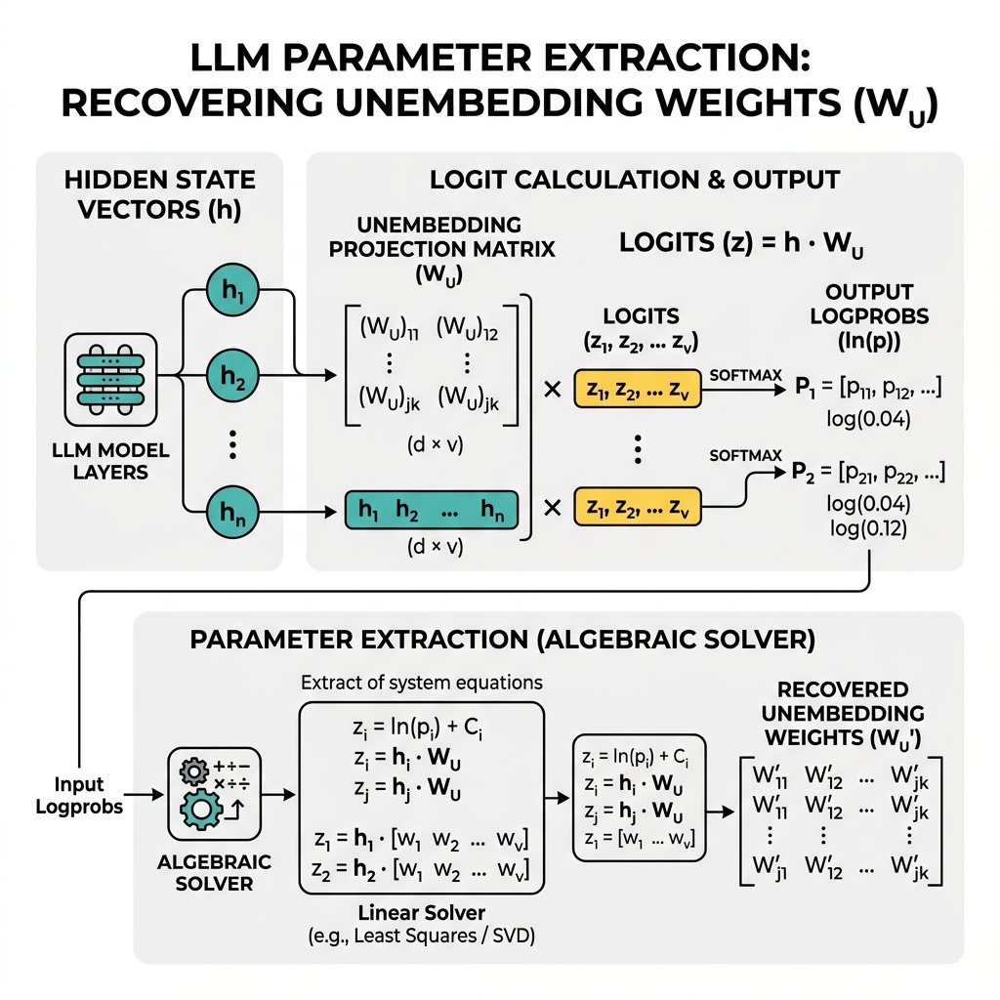

# Reading Guide & Tutorial: Survey on LLM Model Extraction Attacks and Defenses

**Reference**: Kaixiang Zhao, Lincan Li, Kaize Ding, Neil Zhenqiang Gong, Yue Zhao, and Yushun Dong. *A Survey on Model Extraction Attacks and Defenses for Large Language Models.* arXiv preprint arXiv:2508.15031v2, 2025. *(Note: Specialized subset survey focusing on LLM generative spaces)*

---

## 1. Core Summary & Taxonomy

This paper focuses specifically on the challenges of model extraction in **Generative Foundation Models / Large Language Models (LLMs)**. The authors categorize extraction threats into three domains:

### Generative Attack Objectives
1. **Functionality Extraction (Imitation/Leeching)**: Collecting prompts and response completions to fine-tune a smaller open-source model (e.g., using GPT-4 outputs to train Alpaca).
2. **System Prompt Stealing**: Designing adversarial jailbreak prompts to force the LLM to output its proprietary instruction meta-prompts.
3. **Training Data Extraction (Memorization)**: Querying the model with prefixes to trigger memorized sequences from the training corpus.
4. **Parameter Recovery**: Reconstructing the projection weights of the final vocabulary classification layer.

---

## 2. Attack Visualization

Below is the visual workflow representing the algebraic parameter extraction of the final unembedding projection layer from output logprobs:

---

## 3. Explanation Gaps & Deep-Dive Tutorials

Generative AI surveys discuss distillation and prompt leaks, but they skip the rigorous linear algebra of LLM logprob parameter solving and the probability metrics of memorized token recovery.

---

### Gap A: Final Projection Layer Weight Recovery Math

If the LLM API returns output logprobs (the logarithm of probability scores for each vocabulary token), an attacker can extract the exact weights of the final **unembedding projection matrix** $W_U \in \mathbb{R}^{d \times v}$, where $d$ is the hidden state dimension and $v$ is the vocabulary size. The survey references this attack but does not show the linear algebra solver.

#### 1. Mathematical Forward Pass
Let $h \in \mathbb{R}^d$ be the final hidden representation vector before vocabulary projection. The raw logit vector $z \in \mathbb{R}^v$ is calculated as:
$$z = h^T W_U$$

The output probability vector $p \in [0, 1]^v$ is computed using the softmax function:
$$p_i = \frac{e^{z_i}}{\sum_{j=1}^v e^{z_j}}$$

Taking the logarithm of the output probability for token $i$:
$$\ln(p_i) = z_i - \ln\left( \sum_{j=1}^v e^{z_j} \right) = h^T w_i - C$$

where $w_i \in \mathbb{R}^d$ is the $i$-th column of $W_U$, and $C = \ln\left( \sum e^{z_j} \right)$ is a constant normalization scalar for a given query.

#### 2. Constructing the Linear System
If the attacker queries the model with $n$ different prefixes, they obtain $n$ hidden vectors $h_1, \dots, h_n$ (which can be estimated or calculated in white/gray-box settings) and their corresponding output logprobs. For a target vocabulary index $i$, the logprobs across all queries satisfy:

$$\ln(p_i^{(k)}) = h_k^T w_i - C_k \quad \forall k \in \{1, \dots, n\}$$

To eliminate the unknown constant $C_k$, the attacker subtracts the logprob of a reference token (token 0):
$$\ln(p_i^{(k)}) - \ln(p_0^{(k)}) = h_k^T (w_i - w_0)$$

Let $y_i^{(k)} = \ln(p_i^{(k)}) - \ln(p_0^{(k)})$, and define the query matrix $H \in \mathbb{R}^{n \times d}$:
$$H = \begin{pmatrix} h_1^T \\ h_2^T \\ \vdots \\ h_n^T \end{pmatrix}$$

This yields a system of linear equations for the difference vector $\Delta w_i = w_i - w_0$:
$$H \cdot \Delta w_i = Y_i$$
where $Y_i = [y_i^{(1)}, \dots, y_i^{(n)}]^T \in \mathbb{R}^n$.

#### 3. Solving the System
If the attacker collects $n \ge d$ linearly independent query vectors, they solve for the weights difference vector using the **least-squares pseudo-inverse**:
$$\Delta w_i = \left( H^T H \right)^{-1} H^T Y_i$$

By solving this system for all $v$ vocabulary tokens, the attacker recovers the exact relative columns of the projection weight matrix $W_U$, cloning the final layer of the target model.

---

### Gap B: Token Memorization & Privacy Leakage Metrics

LLMs are prone to **memorizing** sequences of training data. An attacker can prompt the model with a prefix $p$ and extract the target suffix sequence $s$. The survey references this privacy leak but does not define the metrics used to confirm memorization.

To determine if a sequence $d = p \mathbin{\Vert} s$ is memorized from the training set $D_{train}$, attackers evaluate the model's output entropy and perplexity:

#### 1. Perplexity (PPL)
Perplexity measures how predicted probability distributions match target sequences. For a generated sequence $S = (s_1, \dots, s_m)$ given prefix $p$:

$$\text{PPL}(S \mid p) = \exp\left( -\frac{1}{m} \sum_{j=1}^m \ln P(s_j \mid p, s_1, \dots, s_{j-1}) \right)$$

A very low perplexity indicates that the model is highly confident in the sequence, suggesting the text was memorized during training rather than generated dynamically.

#### 2. Likelihood Ratio Metric
To prevent false positives (sentences that are common in natural language, like "once upon a time"), attackers compare the target model's perplexity to a reference model $M_{ref}$ (trained on a general dataset):

$$\text{Ratio}(s \mid p) = \frac{\text{PPL}_{T}(s \mid p)}{\text{PPL}_{ref}(s \mid p)}$$

If the target model has significantly lower perplexity than the reference model, it indicates the specific sequence was memorized from the private training set.
