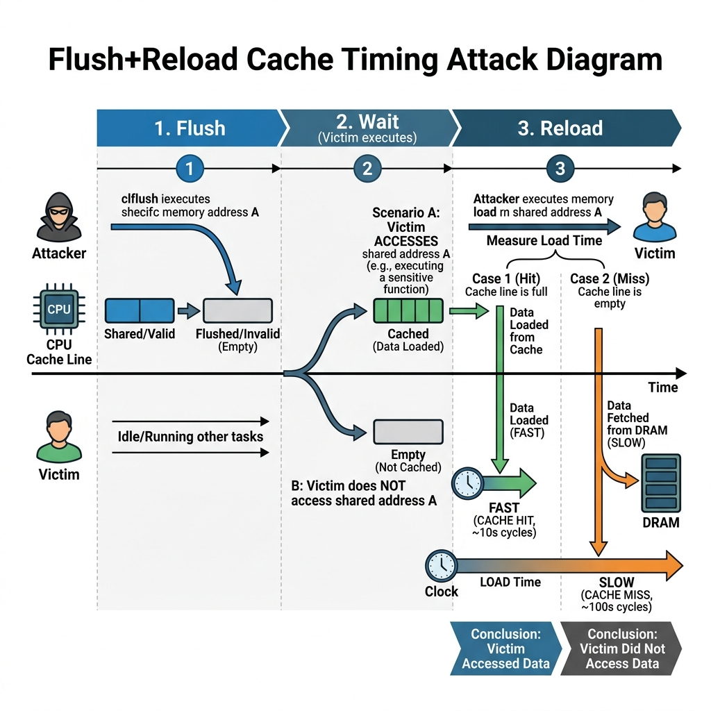

# Reading Guide & Tutorial: SoK: On-Device ML Model Extraction Attacks

**Reference**: Tushar Nayan, Qiming Guo, Mohammed Al Duniawi, Marcus Botacin, Selcuk Uluagac, and Ruimin Sun. *SoK: All You Need to Know About On-Device ML Model Extraction.* USENIX Security Symposium, 2024.

---

## 1. Core Summary & Taxonomy

This paper is a **Systematization of Knowledge (SoK)** that shifts focus away from remote Cloud APIs to **On-Device / Edge ML environments**. When models are deployed locally (on mobile phones, autonomous vehicles, or IoT appliances), the threat model changes because the attacker has physical and local system access to the hardware executing model inference.

### Taxonomy of On-Device Attack Vectors
- **App-Based Extraction**: Statically reverse-engineering the compiled application binaries (such as `.apk` files) to unpack serialized model weights (e.g., `.tflite`, `.onnx`, or `.pb` files).
- **Device-Based Extraction**: Direct memory dumping (RAM scanning) to extract weight parameters stored in plaintext during model initialization.
- **Communication-Based Extraction**: Profiling hardware buses (PCIe bus traffic) or CPU caches during inference execution to reconstruct parameters.
- **Physical Side-Channels**: Monitoring power fluctuations or electromagnetic (EM) emissions.

---

## 2. Attack Visualization

Below is the execution timeline of a **Flush+Reload Cache Side-Channel Attack** used to reconstruct model architectures:

---

## 3. Explanation Gaps & Deep-Dive Tutorials

While this SoK lists Flush+Reload and EM emissions as key edge threats, it assumes the reader is already familiar with CPU cache architecture, virtual page sharing, and signal processing. We address these system-level gaps below.

---

### Gap A: Flush+Reload CPU Cache Timing Mechanics

To reconstruct a model's architecture (number of layers, dimensions, and filter sizes) without querying an API, attackers run **cache timing attacks**. The paper mentions **Flush+Reload**, but does not explain the CPU memory architecture that makes this leakage possible.

#### 1. CPU Cache Hierarchy
Modern CPUs contain three levels of cache memory to speed up memory access:
- **L1 & L2 Caches**: Dedicated to individual CPU cores; very fast but small.
- **L3 Cache (Last-Level Cache - LLC)**: Shared across all CPU cores on the chip.

When a process requests data from a memory address, the CPU first checks L1/L2, then L3 (a **Cache Hit**, taking $\sim 10$ clock cycles). If the data is not in any cache, it must be fetched from main memory (DRAM) (a **Cache Miss**, taking $\sim 200$ clock cycles).

#### 2. Virtual Memory Page Sharing
In modern operating systems, processes use shared libraries (e.g., OpenCV, TensorFlow Lite, or PyTorch runtimes) to save memory. The OS maps these shared libraries to the *same physical memory pages* in DRAM. Thus, the victim model and the attacker's monitoring process share access to the same physical memory space.

#### 3. The Flush+Reload Execution Timeline
The attacker monitors accesses to the shared library functions (such as matrix multiplication or convolution routines) by executing three distinct phases:

1. **FLUSH**: The attacker executes a assembly instruction (e.g. `clflush` in x86) targeting a specific virtual memory address $A$ of the shared library. This forces the CPU to remove that cache line from all cache levels (L1, L2, and L3) down to DRAM.
2. **WAIT**: The attacker pauses execution, allowing the victim model to run. If the victim model executes a neural network layer that calls the monitored multiplication routine, it will load address $A$ from DRAM into the L3 cache. If it does not call the routine, address $A$ remains cleared in DRAM.
3. **RELOAD**: The attacker reloads address $A$ by reading its content, while measuring the time taken using high-resolution CPU timestamp counters (e.g. `rdtscp` instruction):
   - **FAST Access (Cache Hit)**: Access time is low ($\sim 10$ cycles). The attacker deduces that the victim model executed that specific library function.
   - **SLOW Access (Cache Miss)**: Access time is high ($\sim 200$ cycles). The attacker deduces that the victim model did not execute the library function.

By running this Flush+Reload loop continuously, the attacker generates a time-series trace of library calls, mapping the sequence and dimensions of the neural network layers.

---

### Gap B: Physical Side-Channels (EM & Power Analysis)

When models are executed on microcontrollers, GPUs, or hardware accelerators, physical instruction execution draws variable electrical current. The paper references side-channel analysis but omits the signal processing foundations.

Attackers capture these physical leakages using two methods:

#### 1. Simple Power Analysis (SPA)
The attacker connects an oscilloscope to the device's power supply line and monitors power consumption over time. Because different operations (e.g., floating-point multiplication vs. addition) draw different currents, the raw power trace directly visualizes the boundary between model layers, revealing layer depths and activation sequences.

#### 2. Differential Power Analysis (DPA)
To extract exact weight parameters, SPA is insufficient due to noise. Attackers use DPA:
1. **Query & Record**: Query the edge device with $N$ random inputs, recording a high-frequency power consumption trace for each query.
2. **Hypothesize Weights**: For a specific target multiplication $x \cdot w$, guess the value of weight $w$.
3. **Partition & Compare**: Split the $N$ power traces into two groups based on whether the guessed calculation would result in a high-power state (e.g., bit value 1) or low-power state (bit value 0).
4. **Compute Difference of Means**: Subtract the average power trace of Group 0 from Group 1. If the weight guess was correct, a significant spike will appear in the difference trace due to constructive interference. If the guess was incorrect, the differences cancel out as random noise. Repeating this process leaks the exact parameters bit-by-bit.
