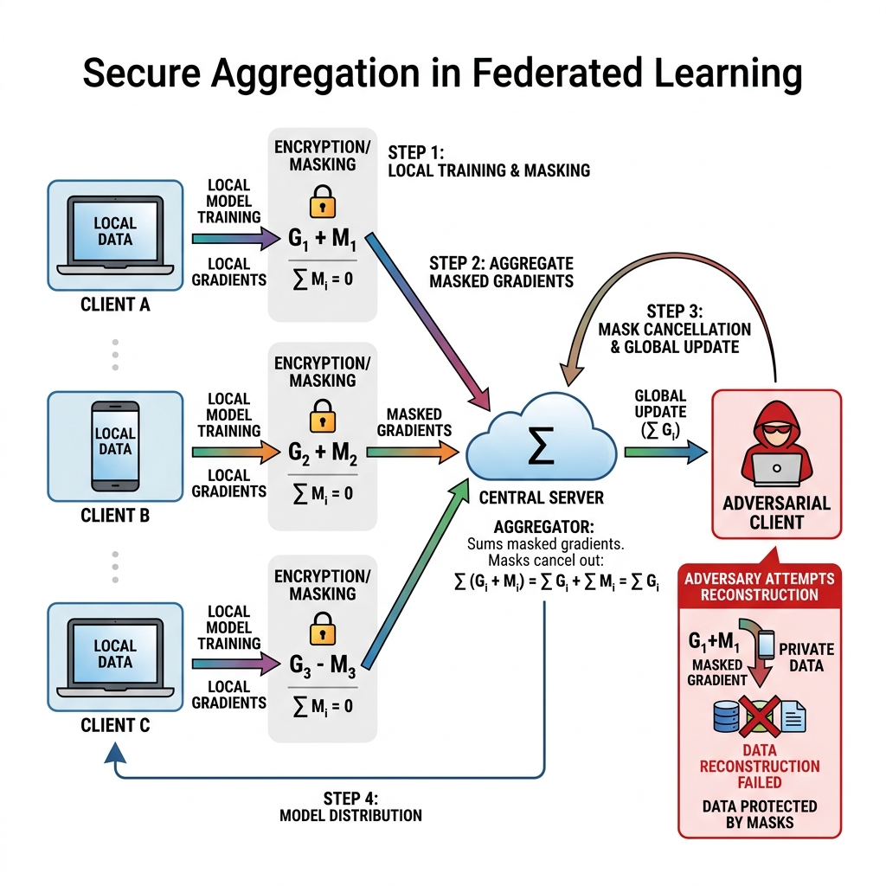

# Reading Guide & Tutorial: Comprehensive Survey of Model Extraction Attacks

**Reference**: Quazi Rian Hasnaine et al. *A Comprehensive Survey of Model Extraction Attacks: Current Trends, Defenses, and Future Directions.* Survey preprint, 2025.

---

## 1. Core Summary & Taxonomy

This survey explores modern trends in model extraction, tracing how attacks have evolved from simple linear query boundaries to complex distributed networks and IoT environments. The authors detail how model parameters are leaked through collaborative training frameworks like **Federated Learning**.

---

## 2. Attack Visualization

Below is the visual workflow representing **Secure Aggregation** in a Federated Learning environment, illustrating the masking steps:

---

## 3. Explanation Gaps & Deep-Dive Tutorials

While this survey lists Federated Learning (FL) and Secure Aggregation as key collaborative frameworks, GNN and FL papers often throw around cryptographic terms like "multi-party masking" and "secure sum" without detailing the underlying algebra.

---

### Gap A: Federated Learning Secure Aggregation Mathematics

In Federated Learning (FL), multiple clients train a global model collaboratively. Instead of sharing their raw datasets, they compute gradient updates locally and send them to a central server, which aggregates them (averaging the parameters) to update the global model.

However, raw gradients leak significant information. An adversary (either a malicious server or a colluding client) can run **Gradient Inversion Attacks** to reconstruct the clients' private training inputs.

To prevent this, FL systems use **Secure Aggregation (SecAgg)**, a cryptographic protocol that allows the server to compute the sum of all client updates without learning any individual update. The survey references this protocol but does not explain how the mathematical masks cancel out.

#### 1. Pairwise Secret Masking
Let there be $U$ clients. Each client $i$ has a local gradient vector $g_i \in \mathbb{R}^M$ that they want to upload. 

1. **Agree on Secret Seeds**: Every pair of clients $(i, j)$ uses a key agreement protocol (like Diffie-Hellman) to generate a shared random seed $s_{i,j}$. By convention, they agree that:
   $$s_{i,j} = -s_{j,i}$$
2. **Generate Pseudo-Random Masks**: Each client uses a pseudo-random generator (PRG) to expand the shared seed into a random masking vector of dimension $M$:
   $$v_{i,j} = \text{PRG}(s_{i,j})$$
   Thus:
   $$v_{i,j} = -v_{j,i}$$
3. **Mask the Gradient**: Before uploading, each client $i$ adds the sum of all its pairwise masks to its local gradient:
   $$y_i = g_i + \sum_{j \neq i} v_{i,j}$$
   Because the masking vector $v_{i,j}$ has the same scale as the gradient, the uploaded vector $y_i$ looks like completely random noise to the server.

#### 2. Server Aggregation & Mask Cancellation
The central server receives the masked updates $y_1, y_2, \dots, y_U$ and sums them together:

$$\sum_{i=1}^U y_i = \sum_{i=1}^U \left( g_i + \sum_{j \neq i} v_{i,j} \right) = \sum_{i=1}^U g_i + \sum_{i=1}^U \sum_{j \neq i} v_{i,j}$$

Let's look at the double sum of masks:
$$\sum_{i=1}^U \sum_{j \neq i} v_{i,j} = \sum_{i < j} \left( v_{i,j} + v_{j,i} \right)$$

Because $v_{i,j} = -v_{j,i}$, every pairwise term in the sum cancels out to zero:
$$v_{i,j} + v_{j,i} = 0$$

Therefore, the double sum of masks is exactly zero:
$$\sum_{i=1}^U \sum_{j \neq i} v_{i,j} = 0$$

The server's aggregated sum simplifies to:
$$\sum_{i=1}^U y_i = \sum_{i=1}^U g_i$$

The server successfully obtains the exact sum of all client gradients, allowing it to update the global model, while learning absolutely nothing about any individual client's gradient $g_i$. This protects client parameters from extraction unless the server colludes with a threshold of clients to reconstruct specific keys.
